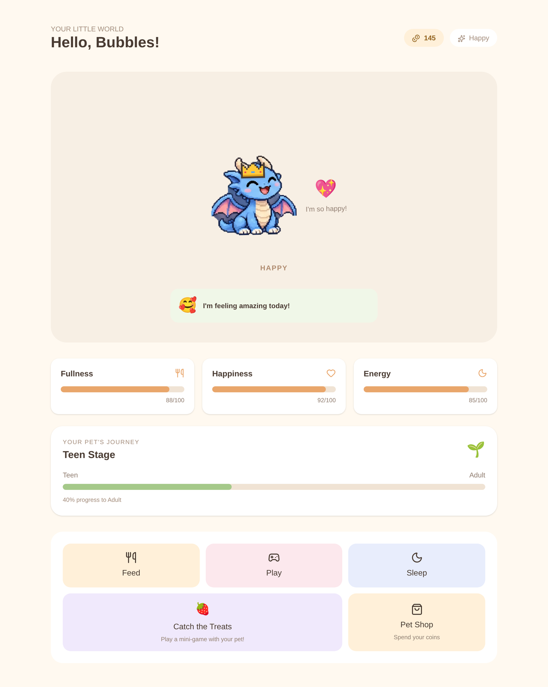
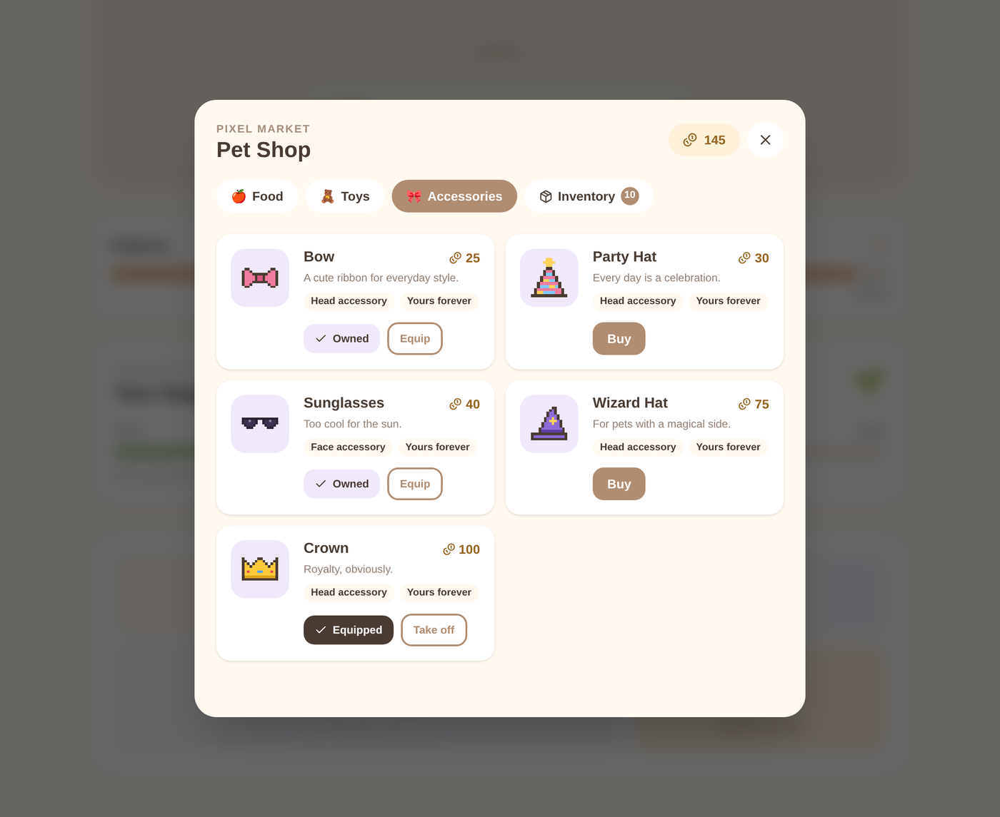
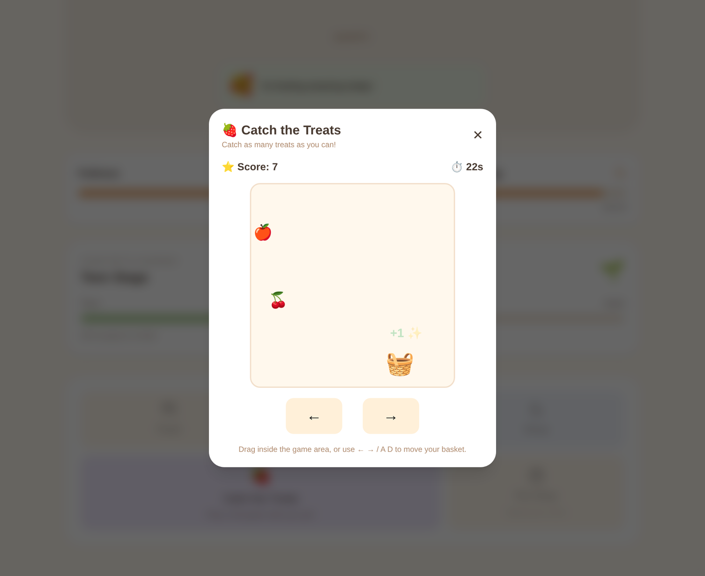
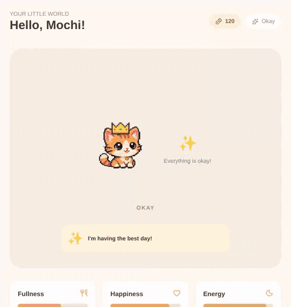

# Adopt a Pixel 🐾

A cozy browser virtual pet game. Adopt a pixel-art pet, give it a name, keep it fed, happy and rested, play a mini-game together, spend your coins in the Pet Shop, and watch it grow from baby to adult.

**Live demo:** _coming soon_ · **Built with:** Next.js · TypeScript · Tailwind CSS · Zustand · Framer Motion

| Dashboard | Pet Shop | Catch the Treats |
|---|---|---|
|  |  |  |



---

## Features

- **Three pets to adopt**: Mochi the cat, Bubbles the dragon and Pickle the frog, each with a custom name.
- **Living stats**: fullness, happiness and energy decay in real time, including while the tab is closed, and are recalculated when you return.
- **Moods**: Happy, Okay, Hungry, Sleepy, Sad and Exhausted, derived from stats and reflected in sprites, animations and messages.
- **Growth**: baby → teen → adult based on the pet's age, with hand-drawn sprites for every stage and mood (45 in total).
- **Timed sleep**: energy recovers over a sleep period, with automatic or manual wake-up that survives refreshes and closed tabs.
- **Daily rewards**: a 7-day repeating streak calendar; missing a day resets the streak.
- **Catch the Treats mini-game**: mouse/touch drag, keyboard and on-screen controls; score-based rewards and a summary screen.
- **Pet Shop**: buy food and toys (consumables) and accessories (permanent cosmetics), with an inventory, equip/unequip, and accessories drawn on the pet.
- **Fully client-side**: no accounts or backend; progress persists in LocalStorage.

## Technical highlights

- **Time-based simulation without a server.** Stats are never ticked blindly; `petEngine.calculatePetStats()` derives the current state from `lastUpdatedAt`, so the same code handles a 30-second refresh and a week away. Store actions that reset the clock first "settle" elapsed decay or sleep recovery, so no time is lost between updates.
- **Validation lives in the store, not the UI.** Purchases, item use and equipping are Zustand actions that re-check everything against the latest state and return typed results (`{ ok: true } | { ok: false, reason }`). Double-clicks can't overspend and permanent items can't be bought twice.
- **Safe persistence.** The store uses `persist` with `skipHydration` and a manual `rehydrate()` gate, so nothing renders from default state and no hydration mismatches occur. The saved shape is versioned with a migration, and a custom `merge` sanitises inventory data from older or corrupted saves.
- **Data-driven shop.** Every price, effect, description and failure message lives in `lib/shopConfig.ts`; components never hard-code item data.
- **Accessories that actually fit.** Each of the 45 sprites is framed differently, so accessories use a per-sprite anchor table (`lib/accessoryPlacement.ts`), set by rendering every accessory onto every sprite and checking it visually. The accessories are pixel art rendered as crisp SVG from character grids (`components/PixelArt.tsx`).
- **Mini-game loop.** `requestAnimationFrame` with delta-time movement, Pointer Events with pointer capture for mouse and touch, held-key input for smooth keyboard movement, ref-based scoring with a caught-ID set to prevent double counting, and a play field that scales to narrow screens.

## Project structure

```text
app/
  layout.tsx, page.tsx        # page shell + store hydration gate
components/
  AdoptionScreen.tsx          # pet selection and naming
  PetDashboard.tsx            # stats, actions, daily rewards, modals
  PixelPet.tsx                # sprite selection, mood animation, accessory overlay
  PetAccessory.tsx, PixelArt.tsx
  mini-game/CatchTheTreats.tsx
  shop/                       # PetShop, ShopItemCard, InventoryPanel, ItemIcon
lib/
  petConfig.ts                # the three pets
  petEngine.ts                # decay, sleep, mood, growth (pure functions)
  shopConfig.ts               # shop catalogue, types, messages
  accessoryArt.ts             # pixel-art accessory grids
  accessoryPlacement.ts       # per-sprite accessory anchors
  miniGameRewards.ts          # score → reward rules
store/
  petStore.ts                 # Zustand store: pet, coins, streak, inventory
public/pets/{pet}/{stage}/{mood}.png
```

## Getting started

```bash
npm install
npm run dev
```

Open [http://localhost:3000](http://localhost:3000).

| Command | Description |
|---|---|
| `npm run dev` | Start the dev server |
| `npm run build` | Production build |
| `npm run start` | Serve the production build |
| `npm run lint` | Run ESLint |

### Test mode

`TEST_MODE` in `lib/petEngine.ts` shortens timers for development (1-minute sleep, 10-second mini-game). It is `false` for production (30-minute sleep, 30-second mini-game).

## Roadmap

- Achievements for milestones (first adoption, feeding streaks, mini-game high scores, reaching adulthood, collecting every accessory)
- Sound effects and optional music
- More mini-games
